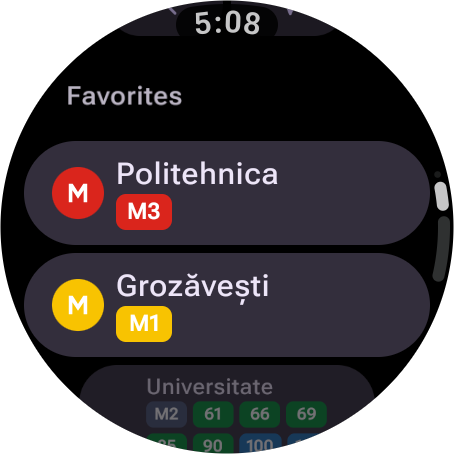
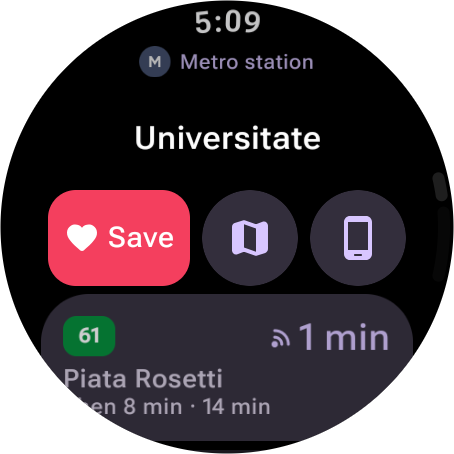
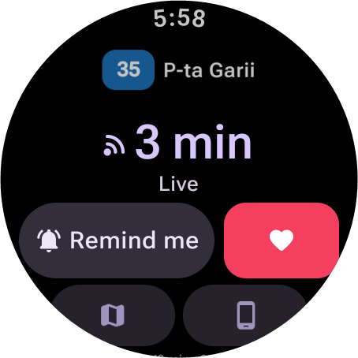
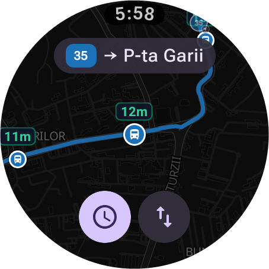
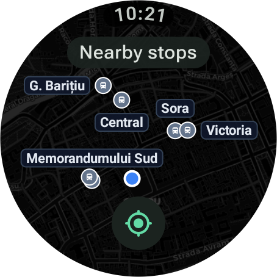
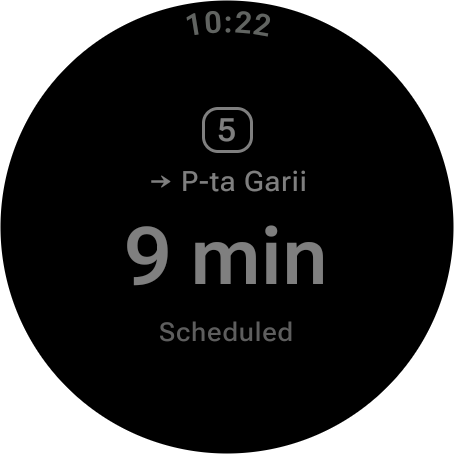
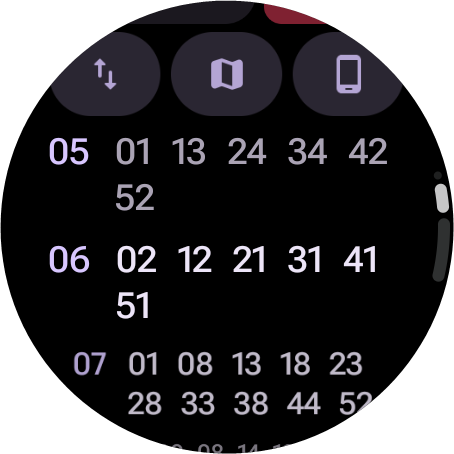

# Conexiuni Cluj for Wear OS

The [Conexiuni Cluj](https://github.com/bmarian/conexiuni-cluj) bus and tram tracker as a native Wear OS app. The website ran in the watch browser, but the browser couldn't get my location, the bezel could only scroll the page, and the page froze every time I lowered my wrist. So I rebuilt it for the watch.

<p align="center">
  
  
  
  
</p>

## What it does

- Favorite stops on the first screen, like Google Maps shows Home and Work
- Search for a stop or a line by voice or keyboard
- Departures for any stop. Tracked buses get a live countdown and the realtime arcs, the rest show the timetable
- Follow a bus: the countdown stays on the watch face, the watch buzzes two minutes before and when it comes, and it lets go once the bus has left
- With the phone app: follow a bus on either device and it shows on both, like Maps navigation on a watch. Stop it on one and it stops on both
- With the phone app: favorites stay the same on both, a stop or a line opens on the phone with one tap, and a journey started on the phone opens on the watch: the current step with a buzz at each new one, and the whole trip on the map, walks included
- A tile with the followed bus and the next departure at your favorite stops, and a Next bus complication for the watch face
- With the wrist down while following, the screen stays on the countdown in always-on mode
- A line opens on the map with the next arrival above each stop, and one tap swaps the direction or shows the timetable
- The stop map shows your favorite lines' buses on their way, with their routes
- The stops within walking distance, as a list or on a map, and your position on every map
- The same map as the phone app: drag and pinch it, turn the bezel to zoom, and the names and times above the stops always show
- Turn the bezel to scroll lists
- Copy your favorites from the website by scanning a code, or typing it on another device

<p align="center">
  
  
  
</p>

## How it works

It talks to the same API as [bus.bmarian.online](https://bus.bmarian.online) and needs no phone app, so it works over Wi-Fi or LTE on its own.

The arrival times are worked out on the watch, with the same logic as the website, ported from TypeScript to Kotlin in [`logic/`](app/src/main/java/online/bmarian/bus/logic). [`ParityTest`](app/src/test/java/online/bmarian/bus/ParityTest.kt) runs both on the same snapshot of real data and fails if a single minute differs.
Stops, lines, timetables and route shapes are kept on the watch, so a stop you've opened before shows up at once and refreshes in the background.

## Building it

You'll need Android Studio with the Android SDK, and a Wear OS emulator or a watch with Wireless debugging turned on.

The map is the phone app's: [MapLibre](https://maplibre.org/) with [OpenFreeMap](https://openfreemap.org/)'s dark style, bundled in [`assets/styles`](app/src/main/assets/styles). No key is needed.

Run the `app` configuration from Android Studio, or:

```bash
./gradlew installRelease
```

The release build is much faster on a watch than the debug one. Without an upload key (below) it's signed with the debug key, so it still installs straight from Android Studio.

```bash
./gradlew testDebugUnitTest
```

runs the parity test.

The release build ships a baseline profile, so the screens people use most are compiled ahead of time. After big UI changes, generate it again on an emulator in English, with its location set near a few Cluj stops:

```bash
ANDROID_SERIAL=emulator-5554 ./gradlew :app:generateBaselineProfile
```

The run uninstalls the app from the device when it ends, so don't point it at your watch.

## Releasing

Google Play needs an upload key. Make one once and keep it somewhere safe, outside the repository:

```bash
keytool -genkeypair -v -keystore upload.jks -alias upload -keyalg RSA -keysize 4096 -validity 10000
```

Then point a `keystore.properties` next to this README at it. Git ignores the file, and the path is relative to this folder:

```properties
storeFile=../keys/upload.jks
storePassword=...
keyAlias=upload
keyPassword=...
```

Raise `versionCode` in [`app/build.gradle.kts`](app/build.gradle.kts) for every upload, then build the bundle:

```bash
./gradlew bundleRelease
```

It lands in `app/build/outputs/bundle/release/app-release.aab`. The store listing text, the icon, the feature graphic and the screenshots are in [`store/`](store), and the privacy policy is [`PRIVACY.md`](PRIVACY.md).

## Credits

Same sources as [the main app](https://github.com/bmarian/conexiuni-cluj#credits): live positions and GTFS from [Tranzy.ai](https://tranzy.ai/), timetables from [CTP Cluj-Napoca](https://www.ctpcj.ro/), map data © [OpenStreetMap](https://www.openstreetmap.org/) contributors, tiles by [OpenFreeMap](https://openfreemap.org/) and [OpenMapTiles](https://openmaptiles.org/), drawn by [MapLibre](https://maplibre.org/). QR codes by [ZXing](https://github.com/zxing/zxing).
