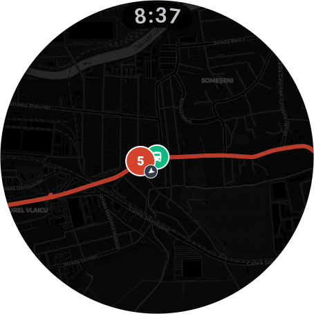
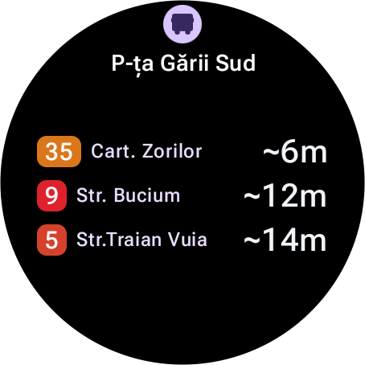

# Conexiuni Cluj for Wear OS

The [Conexiuni Cluj](https://github.com/bmarian/conexiuni-cluj) bus and tram tracker as a native Wear OS app. The website ran in the watch browser, but the browser couldn't get my location, the bezel could only scroll the page, and the page froze every time I lowered my wrist. So I rebuilt it for the watch.

<p align="center">
  
  
  
  
</p>

## What it does

- Favorite stops and lines on the first screen, then nearby stops, every line and every stop
- Departures for any stop. Tracked buses get a live countdown, the rest show approximate times
- A line opens on the map with the next arrival above each stop, and one tap swaps the direction or shows the timetable
- The stop map shows your favorite lines' buses on their way, with their routes
- Turn the bezel to scroll lists and zoom maps
- Your position on the map, and the stops within walking distance
- A tile with the next departures at your first favorite stop
- A complication that counts down to the next bus on your watch face
- Copy your favorites from the website by scanning a code, or typing it on another device

<p align="center">
  
  
</p>

## How it works

It talks to the same API as [bus.bmarian.online](https://bus.bmarian.online) and needs no phone app, so it works over Wi-Fi or LTE on its own.

The arrival times are worked out on the watch, with the same logic as the website, ported from TypeScript to Kotlin in [`logic/`](app/src/main/java/online/bmarian/bus/logic). [`ParityTest`](app/src/test/java/online/bmarian/bus/ParityTest.kt) runs both on the same snapshot of real data and fails if a single minute differs.
Stops, lines, timetables and route shapes are kept on the watch, so a stop you've opened before shows up at once and refreshes in the background.

## Building it

You'll need Android Studio with the Android SDK, and a Wear OS emulator or a watch with Wireless debugging turned on.

The map tiles come from CARTO. Put your key in `local.properties`, which stays out of git:

```properties
carto.key=your_carto_key
```

Then run the `app` configuration from Android Studio, or:

```bash
./gradlew installRelease
```

The release build is much faster on a watch than the debug one. Without an upload key (below) it's signed with the debug key, so it still installs straight from Android Studio.

```bash
./gradlew testDebugUnitTest
```

runs the parity test.

## Releasing

Google Play needs an upload key. Make one once and keep it somewhere safe, outside the repository:

```bash
keytool -genkeypair -v -keystore upload.jks -alias upload -keyalg RSA -keysize 4096 -validity 10000
```

Then point a `keystore.properties` next to this README at it. Git ignores the file, and the path is relative to this folder:

```properties
storeFile=../keys/upload.jks
storePassword=...
keyAlias=upload
keyPassword=...
```

Raise `versionCode` in [`app/build.gradle.kts`](app/build.gradle.kts) for every upload, then build the bundle:

```bash
./gradlew bundleRelease
```

It lands in `app/build/outputs/bundle/release/app-release.aab`. The store listing text, the icon, the feature graphic and the screenshots are in [`store/`](store), and the privacy policy is [`PRIVACY.md`](PRIVACY.md).

## Credits

Same sources as [the main app](https://github.com/bmarian/conexiuni-cluj#credits): live positions and GTFS from [Tranzy.ai](https://tranzy.ai/), timetables from [CTP Cluj-Napoca](https://www.ctpcj.ro/), map data © [OpenStreetMap](https://www.openstreetmap.org/) contributors, tiles by [CARTO](https://carto.com/). QR codes by [ZXing](https://github.com/zxing/zxing).
